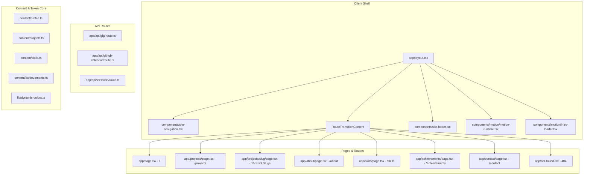
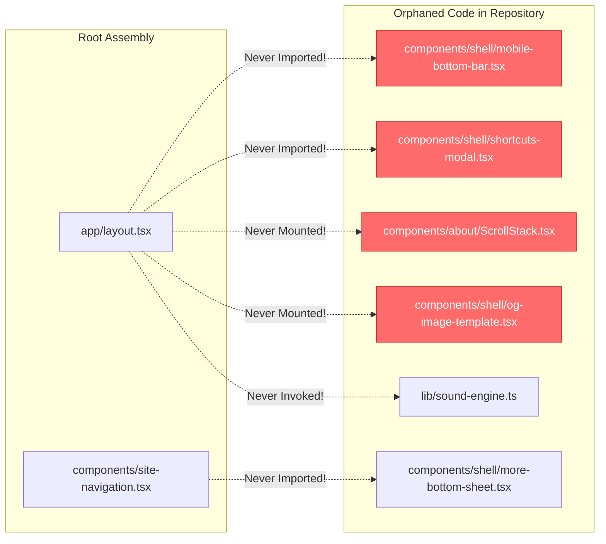
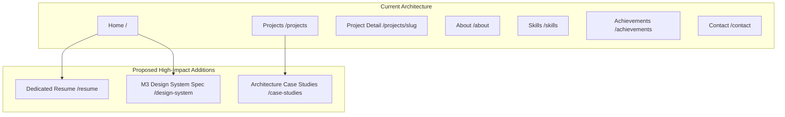
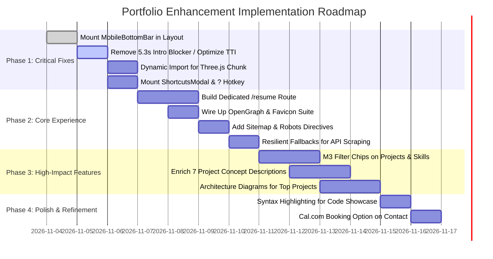

# Portfolio Codebase Audit, Page-by-Page Enhancement & Strategic Roadmap

**Target Project:** Meet Kapadia — Portfolio Website  
**Codebase Version:** Next.js 16.4.3 (Turbopack) · React 19.3.1 · TypeScript 5.9.3 · Material 3 Expressive  
**Audit Author:** Senior Product Designer, Software Architect, UX Engineer, Accessibility Specialist & Technical Portfolio Reviewer  
**Date:** November 2026  
**Scope:** Exhaustive Codebase Inspection, Architectural Evaluation, Page-by-Page Diagnostic, Recruiter Experience Review & Implementation Specification  

---

## 1. Executive Summary

A comprehensive, read-only architectural and UX audit was performed on the Meet Kapadia portfolio repository. The website is an exceptionally advanced, technically rigorous showcase of modern frontend engineering. Built upon Next.js 16.4 App Router, React 19, and Google’s Material Design 3 Expressive specification, the codebase avoids the generic template aesthetics and synthetic claims typical of developer portfolios. Instead, it features an in-house HCT dynamic color engine derived from `@material/material-color-utilities`, fluid spring kinematics, 32-point polygon shape morphing, native View Transitions API orchestration, a 1,465-line custom Three.js physical lanyard simulation, and an automated 51-test suite enforcing strict data-integrity rules (e.g., zero unverified achievements, no fabricated CGPA scales, and no fake metric claims).

However, alongside these remarkable technical achievements, the audit identified **critical architectural disconnects, UX friction points, and missed recruiter-conversion opportunities**:

1. **The Mobile Navigation Blackout:** A severe breakpoint rule in `app/globals.css` (`@media (max-width: 599px) { .site-header .navigation { display: none !important; } }`) hides the top navigation links on mobile devices under 600px. While a dedicated `MobileBottomBar` and `MoreBottomSheet` were authored in `components/shell/`, **they were never imported or rendered in `app/layout.tsx`**. As a result, mobile visitors are completely stranded without primary navigation controls.
2. **Recruiter Friction via Intro Loader:** A full-screen 3D lanyard loader (`components/motion/intro-loader.tsx`) enforces a **5.3-second blocking sequence** (`progressDurationMs = 3800` + `holdAfterCompleteMs = 1500`). Because `app/layout.tsx` clears `sessionStorage` on every execution, this blocking loader triggers on every reload and page refresh, degrading Time to Interactive (TTI), First Contentful Paint (FCP), and recruiter patience.
3. **Severe Initial Bundle Weight (Three.js Monolith):** Because `IntroLoader` is statically imported directly into `app/layout.tsx`, the 1,465-line Three.js simulation and the 607 KB `three` bundle are bundled into the global client bundle, penalizing every single page on the site (`/about`, `/skills`, `/projects`, `/contact`) regardless of whether 3D graphics are in view.
4. **Orphaned / Abandoned Production Code:** Substantial, high-quality components have been written, styled, and tested, but sit unreferenced in the tree:
   - `components/shell/mobile-bottom-bar.tsx` & `mobile-bottom-bar.module.css`
   - `components/shell/more-bottom-sheet.tsx`
   - `components/shell/shortcuts-modal.tsx` & `shortcuts-modal.module.css` (the `?` shortcut helper)
   - `components/about/ScrollStack.tsx` (a 387-line GPU-accelerated card pinning engine)
   - `components/shell/og-image-template.tsx` (an automated OpenGraph image renderer)
   - `lib/sound-engine.ts` (a Web Audio API synthesizer for tactile micro-interactions)
5. **Fragile Server-Side Scraping Routes:** The API routes `/api/gfg`, `/api/github-calendar`, and `/api/leetcode` attempt runtime regex scraping and browser user-agent spoofing against external endpoints without fallback resilience or webhooks, leaving them vulnerable to Cloudflare bot protection and 502 Bad Gateway responses in serverless deployments.
6. **Incomplete Project Case Studies:** While lead projects like `RepoGrade` and `Hindsight` possess strong technical identities, 7 out of 15 public projects in `content/projects.ts` are listed as bare concepts with `tagline: null`, missing architectures, and absent screenshots, which dilutes the technical density of the catalog.
7. **SEO & Discoverability Vacuum:** Despite containing an `og-image-template.tsx`, there are no Next.js `opengraph-image.tsx` or `twitter-image.tsx` handlers, no `sitemap.ts`, no `robots.ts`, no `favicon.ico`, and no Schema.org JSON-LD structured data.

This document serves as the complete, authoritative specification to resolve every identified defect, unlock orphaned capabilities, elevate recruiter conversion, and establish an industry-leading technical portfolio.

---

## 2. Overall Codebase Overview

### 2.1 Project Structure & System Architecture
- **Framework & Runtime:** Next.js 16.4.3 using the App Router with Turbopack bundler, running on React 19.3.1 and Node.js v24.22.1.
- **Language & Type System:** TypeScript 5.9.3 configured with strict type checking, `noEmit: true`, and zero build-time type errors.
- **Routing Architecture:** File-system based App Router located under `portfolio/app/`. Contains 7 top-level page routes, 1 dynamic route (`/projects/[slug]`), 1 root 404 handler (`not-found.tsx`), and 3 internal API endpoints (`/api/*`).
- **Rendering Strategy:** Hybrid static/incremental architecture. 6 static pages (`/`, `/_not-found`, `/about`, `/contact`, `/projects`, `/skills`), 15 statically pre-rendered project detail paths generated via `generateStaticParams()`, and 1 ISR page (`/achievements`) revalidated hourly with dynamic server streaming.
- **State & Communication Architecture:** Native React state primitives combined with window-level Custom Events (`portfolio:theme-choice`, `portfolio:route-intent`, `portfolio:route-request`, `portfolio:global-color-applied`) to decouple shell controls from page internals.
- **Test Infrastructure:** Node.js native test runner (`node:test`) executed via `tsx --test tests/*.test.tsx`. 51 comprehensive integration tests covering DOM accessibility, SSR markup contracts, M3 color contrast, and verification boundaries.

---

## 3. Technology Stack Audit

| Technology | Location & Purpose | Architectural Assessment | Optimization Opportunity |
| :--- | :--- | :--- | :--- |
| **Next.js 16.4.3** | `portfolio/app/` — Application framework, SSG, ISR, and metadata engine. | **Appropriate.** Excellent use of modern App Router features, static generation, and prefetching. | Wire up Next.js 16 Metadata OpenGraph handlers (`opengraph-image.tsx`) and manifest/sitemap generators. |
| **React 19.3.1** | Core UI library across all client and server components. | **Appropriate.** Leverages `useTransition`, `useId`, and native `Suspense` boundaries cleanly. | Eliminate unnecessary `"use client"` directives on static leaf components; fix hydration warnings. |
| **Material Color Utilities** (`@material/material-color-utilities`) | `portfolio/lib/dynamic-colors.ts` — Computes 37 semantic M3 roles from any hex seed using the HCT color space. | **Excellent.** Accurately implements Google's CAM16 perceptual contrast algorithms. | Already dynamically imported on demand; maintain this separation to keep initial bundles lean. |
| **Three.js** (`three` 0.187.0) | `portfolio/components/motion/Lanyard.tsx` — Custom WebGL 3D physics-based badge simulation. | **Problematic in current location.** 607 KB bundle loaded globally on every route via `IntroLoader`. | Move `Lanyard` to a dynamic `next/dynamic` chunk loaded only when explicitly requested by user interaction. |
| **Framer Motion 14.7.1** | `components/motion/`, `components/ui/`, `components/site-navigation.tsx` — Layout projection and modal transitions. | **Appropriate but occasionally redundant.** Coexists alongside Web Animations API (WAAPI) and CSS View Transitions. | Consolidate micro-animations to pure CSS / WAAPI to reduce JavaScript thread competition during page navigation. |
| **Lenis 1.3.27** | `components/motion/motion-runtime.tsx` — Smooth wheel scrolling and momentum interpolation. | **Appropriate.** Disabled for reduced-motion and touch devices; properly integrated with anchor navigation. | Ensure Lenis instance cleanly pauses during modal overlays to prevent background wheel scrolling. |
| **Variable Fonts** (Manrope & DM Sans) | `@fontsource-variable/` in `app/layout.tsx` and `app/globals.css`. | **Well implemented.** Local WOFF2 variable fonts loaded via `next/font/local` with fallback CSS variables. | Add `preload: true` hints and ensure typography tokens are consistent across all page headings. |
| **Node Test Runner** (`node:test` + `tsx`) | `portfolio/tests/*.test.tsx` — 51 static SSR assertion suites. | **Outstanding.** Extremely fast (~1.5s runtime), zero bloated test harnesses (no Jest/Karma), highly reliable. | Expand test coverage to include mobile navigation rendering, keyboard shortcut handling, and API fallbacks. |

---

## 4. Existing Routes & Page Inventory

| Route | Source File | Rendering Strategy | Navigation Discoverability | Status & Gaps |
| :--- | :--- | :--- | :--- | :--- |
| `/` | `app/page.tsx` | Static (`○`) | Primary Top Navigation, Brand Logo | **Active.** Hero, impact metrics, featured projects, skills summary, SVG mask demo, 3D pass modal. |
| `/projects` | `app/projects/page.tsx` | Static (`○`) | Primary Top Navigation | **Active.** Filterable catalog (category, status, query), expandable project dialogs. |
| `/projects/[slug]` | `app/projects/[slug]/page.tsx` | SSG (`●` 15 Slugs) | Direct links from `/` and `/projects` | **Active.** 15 pre-rendered case study pages. Only 4 contain rich media/reflections; 11 are sparse. |
| `/about` | `app/about/page.tsx` | Static (`○`) | Primary Top Navigation | **Active.** Bio, principles bento, education, experience milestones, campus clubs, learning tracks. |
| `/skills` | `app/skills/page.tsx` | Static (`○`) | Primary Top Navigation | **Active.** Interactive skills matrix, search, category pills, Code Craftsmanship showcase, Systems Roadmap. |
| `/achievements` | `app/achievements/page.tsx` | ISR (`○` 1h reval) | Primary Top Navigation | **Active.** Internship, hackathons, certifications, live LeetCode/CodeChef/GFG metrics, GitHub heatmap. |
| `/contact` | `app/contact/page.tsx` | Static (`○`) | Primary Top Navigation, Hero Buttons | **Active.** Direct email link, copy email button, validated client form opening `mailto:`, social profiles. |
| `/_not-found` | `app/not-found.tsx` | Static (`○`) | Automatic on 404 | **Active.** Semantic 404 message with home button. |
| `/api/gfg` | `app/api/gfg/route.ts` | ISR (`○` 1h reval) | Internal API endpoint | **Fragile.** Direct regex HTML scraping of GeeksforGeeks profile with hardcoded fallback. |
| `/api/github-calendar` | `app/api/github-calendar/route.ts`| ISR (`○` 1h reval) | Internal API endpoint | **Fragile.** Direct regex scraping of GitHub contributions SVG/HTML table without PAT token. |
| `/api/leetcode` | `app/api/leetcode/route.ts` | ISR (`○` 1h reval) | Internal API endpoint | **Fragile.** Direct GraphQL POST to `leetcode.com` with browser user-agent spoofing. |

---

## 5. Existing Functionality Inventory & Defect Log

### 5.1 Interactive Elements & State Integrity Audit
- **Theme Switcher (`ThemeToggle` in `components/interface-controls.tsx`):**
  - **Behavior:** Offers Light, Dark, and System modes via semantic radio buttons. Features a circular radial clip-path view transition (`runThemeReveal`) emanating from the clicked icon button.
  - **Verdict:** Fully functional, highly polished, WCAG contrast compliant.
- **Color Seed Engine (`ColorSeedPicker` in `components/color-seed-picker.tsx`):**
  - **Behavior:** `
` dropdown with preset swatches and a custom hex input. Dynamically computes 37 M3 color tokens and dispatches global CSS variable updates without page reload.
  - **Verdict:** High-value differentiator. Functions flawlessly.
- **Command Palette (`CommandPalette` in `components/command-palette.tsx`):**
  - **Behavior:** Triggered via `⌘K` / `Ctrl+K` or search button. Features fuzzy scoring, recent items persistence in `localStorage`, full arrow-key and Escape handling, and route navigation.
  - **Verdict:** Functional and fast. However, missing shortcuts to view resume directly or copy project links.
- **Filter Bars (Projects `/projects` and Skills `/skills`):**
  - **Behavior:** Debounced live text search, category pills, and status dropdowns. Synchronizes parameters to the browser address bar via `window.history.replaceState`.
  - **Verdict:** High quality; properly handles browser back/forward buttons via `popstate` listeners.
- **Contact Form (`components/contact/contact-page.tsx`):**
  - **Behavior:** Client-side validation for name, subject, and message. Does not submit to an external server; prepares a structured `mailto:` link and triggers the user's default email client while firing a live toast notification.
  - **Verdict:** Reliable and honest (clearly informs the visitor that no data is retained or transmitted).

### 5.2 Identified Disconnects, Broken Affordances & Dead Code

1. **Mobile Bottom Navigation Abandonment:**
   - **File:** `portfolio/components/shell/mobile-bottom-bar.tsx`
   - **Defect:** `app/globals.css` lines 128–156 explicitly hide `.site-header .navigation` when `max-width < 600px` and reserve 88px padding at the bottom of the viewport for a bottom navigation bar. However, `MobileBottomBar` is **never rendered anywhere in `app/layout.tsx`**. On mobile phones, users have no navigation bar.
2. **Keyboard Shortcuts Helper Modal Disconnected:**
   - **File:** `portfolio/components/shell/shortcuts-modal.tsx`
   - **Defect:** `content/shortcuts.ts` defines `?` as the hotkey to view all shortcuts. The component `ShortcutsModal` exists with complete focus trapping, tab navigation, and M3 dialog styling, but is completely omitted from the layout.
3. **Abandoned `ScrollStack.tsx` Component:**
   - **File:** `portfolio/components/about/ScrollStack.tsx`
   - **Defect:** A 387-line custom component implementing GPU-accelerated sticky stacking card physics sits unreferenced in `components/about/`.
4. **Disconnected OpenGraph Engine:**
   - **File:** `portfolio/components/shell/og-image-template.tsx`
   - **Defect:** A 288-line automated SVG/JSX image generator designed for `@vercel/og` (`ImageResponse`) with custom typography and M3 color roles exists in `components/shell/`, but no `opengraph-image.tsx` routes exist in `app/`.
5. **Three.js Deprecation Warning in Tests:**
   - **Warning:** `(node:2772) [THREE_CJS_DEPRECATED] DeprecationWarning: require("three") is deprecated and will be removed. Replace const THREE = require("three") with import * as THREE from "three"`.
   - **Root Cause:** A test file or dynamic import touches a CommonJS wrapper for Three.js.

---

## 6. Page-by-Page Comprehensive Audit

---

### Page: Home
**Route:** `/`  
**Source Files:** `portfolio/app/page.tsx`, `portfolio/components/home/home-page.tsx`, `portfolio/components/home/project-card.tsx`, `portfolio/styles/home.css`

#### A. Current Implementation
- **Section Order:**
  1. Hero section with live building status pill (`Currently building RepoGrade`), location metadata, headline, animated text description (`TextGenerateEffect`), hero skill labels, and 5 action buttons (Explore Work, View Resume, Get in Touch, GitHub, LinkedIn).
  2. Hero art frame with 8-petal CSS bloom illustration, interactive `MorphingShape` badge, and "Inspect 3D Pass" trigger button opening the physics modal.
  3. Key engineering velocity strip: 4 stat cards (650+ LeetCode, 8+ Full-Stack Builds, 8.31 CGPA, 100% Local-First AI).
  4. Selected Projects grid: Category filter bar ("All Featured", "Developer tooling", "Local AI", "Sports booking", "Corporate websites", "AI / Optimization") rendering 5 featured project cards (`ProjectCard`) with tone-specific container styling and lead card layout.
  5. Skills overview section with two-column definition list mapping 8 skill groups.
  6. Interactive Design Philosophy spotlight: `SVGMaskEffectDemo` revealing masked design principles on mouse drag/hover.
  7. Bottom CTA banner inviting contact with email and LinkedIn links.
  8. 3D Lanyard Modal (`inspectBadge` state) displaying full WebGL interactive badge.

#### B. What Is Working Well
- **Strong Technical Identity:** The hero immediately establishes Meet as an engineer interested in systems, local AI, and full-stack development, supported by authentic institutional facts (IIIT Vadodara, 8.31 CGPA).
- **M3 Expressive Aesthetics:** The interactive shape morphing (`MorphingShape`) and tone-based surface layering create a memorable, premium tactile experience.
- **Zero Hallucinated Metrics:** Every metric in the velocity ribbon ties directly to verified records.

#### C. Issues & Missing Opportunities
1. **Recruiter Wall via 5.3s Intro Loader:** Recruiters landing on `/` are obstructed by a 5.3-second blocking intro animation before seeing the hero content.
2. **External Resume Friction:** The "View Resume" button directs users away to an external URL (`https://miniresumemeet.vercel.app`) rather than offering an integrated viewer or instant PDF download.
3. **Redundant Project Card Filtering:** The category filter on Home duplicates the functionality of `/projects` while only containing 5 items, creating unnecessary cognitive load.
4. **Heavy Global Three.js Chunk:** Three.js is loaded even if the user never clicks "Inspect 3D Pass".

#### D. Recommended Enhancements

##### Essential Improvements
- **Bypass Intro Loader for Returning & Recruiter Visitors:** Store an intro bypass token in `localStorage` after first run. Reduce animation timeout to 1.8s max and provide an immediate, high-contrast "Skip" button.
- **Direct Resume Quick-Actions:** Upgrade the hero resume button with a split-dropdown: "Quick Preview" (in-modal) and "Download PDF".
- **Dynamic Lazy Loading for 3D Lanyard:** Replace direct import of `Lanyard` with `next/dynamic(() => import(...), { ssr: false })` so the 607 KB WebGL bundle is fetched only when "Inspect 3D Pass" is activated.

##### High-Impact Enhancements
- **Lead Project Architectural Callout:** Enhance the top featured project card (`RepoGrade`) with an interactive architecture preview (AST engine pipeline diagram and live GitHub health badge).
- **Interactive Terminal Preview:** Introduce an expandable, copyable CLI snippet (e.g. `curl -sL https://meetkapadia.dev/api/summary | jq .`) demonstrating real developer polish.

##### Experimental Ideas
- **Interactive M3 HCT Live Sliders:** Let design-oriented recruiters tweak the HCT chroma and tone directly in the hero art frame to see the entire portfolio's color scheme adapt in real time.

#### E. Missing Content & Evidence
- [USER INPUT REQUIRED] Verified Resume PDF placed in `public/resume-meet-kapadia.pdf`.
- [USER INPUT REQUIRED] High-resolution screenshot of `RepoGrade` live dashboard to replace the static badge image.

#### F. Suggested Page Structure
1. Hero Header & Building Status Pill (Retain)
2. Impact & Velocity Metrics Ribbon (Retain & add real-time tooltips)
3. Curated Engineering Highlights (3 flagship case studies, remove redundant filters)
4. Interactive System Architecture / Design Philosophy (Retain `SVGMaskEffect`)
5. Skills & Core Tooling Snapshot (Streamline into interactive chips linking to `/skills`)
6. Contact & Direct Connect Banner (Retain)

---

### Page: Projects Catalog
**Route:** `/projects`  
**Source Files:** `portfolio/app/projects/page.tsx`, `portfolio/components/projects/project-catalog.tsx`, `portfolio/components/projects/catalog-card.tsx`, `portfolio/lib/project-catalog.ts`

#### A. Current Implementation
- **Section Order:**
  1. Header with eyebrow, page title ("Projects."), collection label, and morphing spark art.
  2. Filter Toolbar: Live search input with clear button, Category dropdown, Status dropdown, and "Clear filters" action.
  3. Live result count status banner (`role="status" aria-live="polite"`) with quick jump links to groups.
  4. Three grouped project sections:
     - **Featured:** `RepoGrade`, `Hindsight`, `PlayHub`, `BD Buildcon`, `API Traffic Optimizer`.
     - **More Projects:** `LearnFlex`, `Mann Beauty Studio`, `WanderStay`.
     - **Explorations & Ideas:** 7 concepts (`Coastal Blue Carbon`, `Hydrogen Map`, `Green Hydrogen Credits`, `RobustVision`, `Peer Skill Swap`, `Pocket NoticeBoard`, `Receipt Scanner`).
  5. Expandable Project Modal (`ExpandableProjectModal`): Container-transform modal presenting project details, stack tags, and repository links.

#### B. What Is Working Well
- **Honest Differentiation:** Prototypes and concepts are explicitly marked with distinct styling (`concept`, `prototype`) and separated from shipped work, maintaining total professional credibility.
- **Stateful URL Search Synchronization:** Searching or filtering immediately synchronizes URL query params (`?q=...&category=...&status=...`), allowing filtered views to be shared.
- **Keyboard & Modal Trapping:** Expandable cards support Escape closing and trap focus properly.

#### C. Issues & Missing Opportunities
1. **Uneven Content Quality:** The 7 "Explorations & Ideas" projects have no descriptions, screenshots, or stack tags. They appear as empty grey boxes with only a title, dragging down the overall perceived polish.
2. **Missing Multi-Select Filter Chips:** Dropdown `<select>` elements for Category and Status feel dated compared to modern M3 segmented filter chips.
3. **No Direct Demo Links on Cards:** Users must click into the card or modal to find external live URLs or GitHub links.

#### D. Recommended Enhancements

##### Essential Improvements
- **Elevate Exploration Cards:** Add brief 1-line problem statements and intended architectures for all 7 concept entries in `content/projects.ts` (e.g., explaining the technical premise of `Coastal Blue Carbon` or `Hydrogen Map`).
- **Surface Action Shortcuts on Hover:** Provide immediate "GitHub" and "Live Demo" icon buttons directly on catalog cards so recruiters can jump straight to code without entering the modal.

##### High-Impact Enhancements
- **Replace Select Dropdowns with M3 Filter Chips:** Convert category and status selectors to a scrollable horizontal filter chip group with active checkmarks matching the Skills page aesthetic.
- **Repository Health & Star Badges:** Integrate live GitHub repository metrics (stars, forks, open issues) directly into card footers for verified repositories (`RepoGrade`, `Hindsight`, `PickleRage_Booking`).

##### Experimental Ideas
- **Interactive In-Browser Project Demos:** For projects like `Hindsight` or `RepoGrade`, embed an interactive sandbox widget or simulated terminal demonstrating sample inputs and outputs.

#### E. Missing Content & Evidence
- [USER INPUT REQUIRED] Brief 1–2 sentence problem statements for the 7 exploration concepts.
- [USER INPUT REQUIRED] Live demo deployment URLs or screenshots for `LearnFlex` and `WanderStay`.

#### F. Suggested Page Structure
1. Page Header & Live Filter Toolbar (M3 Filter Chips + Search Input)
2. Featured Production Builds (Large cards with architecture diagrams and live links)
3. Systems & Collaborative Engineering (`LearnFlex`, `Mann Beauty Studio`, `WanderStay`)
4. Technical Explorations & Research Concepts (Compact cards with clear technical premises)

---

### Page: Project Detail
**Route:** `/projects/[slug]` (15 Dynamic Routes)  
**Source Files:** `portfolio/app/projects/[slug]/page.tsx`, `portfolio/components/projects/project-detail.tsx`, `portfolio/lib/project-detail.ts`

#### A. Current Implementation
- **Section Order:**
  1. Back button (`All projects`) with prefetching.
  2. Header with category breadcrumb, project title, status badge, unverified warning if applicable, and morphing header shape.
  3. Main content area:
     - Overview section (`TextGenerateEffect`).
     - Problem statement.
     - Role & team context.
     - Technology stack tags.
     - Key features checklist.
     - Media gallery (`<Image>` and `<video>` embeds).
     - Engineering Reflections (Challenges & Lessons Learned).
     - External Links (Repository & Live Demo buttons).
     - Status & verification panel.
  4. Sticky sidebar with "On this page" anchor navigation.
  5. Pagination bar with Previous and Next project links.

#### B. What Is Working Well
- **Deep Architectural Storytelling (RepoGrade & Hindsight):** `RepoGrade` and `Hindsight` include genuine engineering depth, documenting trade-offs (e.g. Win32 screen capture vs electron bloat, AST parsing vs naive regex).
- **Responsive Layout:** Sidebar seamlessly stacks on smaller viewports.
- **Strict SSG Route Boundary:** Unknown or review-only slugs return a clean 404 rather than an empty page.

#### C. Issues & Missing Opportunities
1. **Empty Pages for Concept Projects:** Slugs 9 through 15 render nearly empty detail pages because `overview`, `problem`, `stack`, and `features` are `null`.
2. **Missing Architecture Diagrams:** Pure text descriptions make complex systems (like RepoGrade's monorepo pipeline or Hindsight's vector pipeline) harder to digest quickly.
3. **Image Optimization Warning:** Line 45 of `project-detail.tsx` uses raw unoptimized `` tags for media lacking hardcoded dimensions, triggering an ESLint warning.

#### D. Recommended Enhancements

##### Essential Improvements
- **Populate Core Details or Restrict Routing:** Either provide foundational problem/stack content for the 7 concept projects in `content/projects.ts`, or restrict `/projects/[slug]` dynamic generation to projects with substantial case studies (`order <= 8`).
- **Fix Unoptimized `` Warning:** Replace raw `` with Next.js `<Image fill ... />` within a responsive aspect-ratio container.

##### High-Impact Enhancements
- **System Architecture Visualizations:** Include clean Mermaid or SVG architecture diagrams for `RepoGrade` (Next.js → Turborepo → tree-sitter → Inngest → Postgres) and `Hindsight` (Win32 Hook → Tesseract OCR → Ollama Embeddings → SQLite-Vec).
- **Code Snippet Highlights:** Add an expandable "Key Technical Implementation" code block on each detail page highlighting the most complex algorithmic module.

##### Experimental Ideas
- **Live Interactive API Playground:** For `RepoGrade`, embed a lightweight widget allowing a visitor to type a public GitHub username and view live calculated metrics.

#### E. Missing Content & Evidence
- [USER INPUT REQUIRED] Architecture diagrams or flowcharts for `RepoGrade`, `Hindsight`, and `PlayHub`.
- [USER INPUT REQUIRED] Decision on whether concept projects (`coastal-blue-carbon`, etc.) should have individual detail routes or remain catalog-only cards.

#### F. Suggested Page Structure
1. Project Header & Quick Metadata Bar (Role, Timeline, Status, Live Links)
2. Executive Summary & Problem Space
3. Architecture & Data Flow Diagram
4. Key Engineering Challenges & Technical Trade-offs
5. Shipped Media Gallery & Video Walkthroughs
6. Quantitative Impact & Outcomes
7. Sequential Pagination (Previous / Next Project)

---

### Page: About
**Route:** `/about`  
**Source Files:** `portfolio/app/about/page.tsx`, `portfolio/components/about/about-page.tsx`, `portfolio/components/about/about-page.module.css`

#### A. Current Implementation
- **Section Order:**
  1. Header with eyebrow, "About Meet.", and secondary decorative icon.
  2. Bio & "How I Build" Bento: 4 principles (Grounded in Reality, Local-First & Privacy, M3 Expressive Aesthetics, Deep Fundamentals) with primary, secondary, tertiary, and accent tone borders.
  3. Daily Tooling Strip: Horizontal pill list of daily technologies (Neovim, VS Code, Windows Terminal, Arch/WSL, TypeScript, Go, Python, etc.).
  4. Background Grid:
     - **Education Column:** IIIT Vadodara (B.Tech CSE, 2024–2028, 8.31 CGPA), Cosmos Castle International School (Class XII, 89.8%), Sanskar Vidhya Bhavan (Class X, 92.33%).
     - **Experience & Milestones Column:** Bhumi Developers internship, Supermemory hackathon, Systems Architecture milestone. Includes document assist chips.
  5. Campus Communities Bento: 3 club cards (9bit Technical Community, Dot Design Club, Obscura Photography Club) with morphing shapes.
  6. Learning & Future Exploration: Active learning topics (Machine Learning, Generative AI, LangGraph, LangChain, Concurrency in Go) and upcoming research areas.

#### B. What Is Working Well
- **Honest Academic & Professional Records:** Educational institutions and scores are stated precisely without artificial rounding or inflated claims.
- **Multitonal M3 Timeline:** Beautiful timeline track connecting milestones with custom morphing shape nodes.
- **Comprehensive Extracurricular Context:** Photography and design club leadership demonstrate a well-rounded creative and technical perspective.

#### C. Issues & Missing Opportunities
1. **Static Document Chips:** The internship certificate and recommendation letter display as static non-clickable chips (`url: null`), which may cause recruiters to assume links are broken.
2. **Missing Portrait / Professional Headshot:** `profile.portrait` is set to `null`, leaving the page without a personal human element.
3. **Dead Component in Directory:** `components/about/ScrollStack.tsx` exists in the folder but is not utilized.

#### D. Recommended Enhancements

##### Essential Improvements
- **Clarify Document Availability:** Add a helper label to non-linked document chips (e.g. `Available upon request`) or upload verified PDFs to `public/certificates/`.
- **Add Verified Professional Portrait:** Add a clean, high-resolution portrait in the bio bento with proper fallback styling.

##### High-Impact Enhancements
- **Interactive Career Trajectory Toggle:** Allow recruiters to toggle between "Engineering Focus" (technical milestones) and "Complete Timeline" (academic + community).
- **Downloadable Profile Dossier:** Provide a 1-click button to download an executive 1-page PDF summarizing Meet's background, coursework, and contact details.

##### Experimental Ideas
- **Photography & Design Mini-Gallery:** Since Meet coordinates the Obscura Photography and Dot Design clubs, embed a subtle modal preview showcasing 3-4 selected photographs or UI designs.

#### E. Missing Content & Evidence
- [USER INPUT REQUIRED] Professional headshot photo for `public/meet-portrait.webp`.
- [USER INPUT REQUIRED] PDF files for Bhumi Developers internship certificate and recommendation letter.

#### F. Suggested Page Structure
1. Header & Executive Bio with Portrait
2. "How I Build" Engineering Philosophy Bento
3. Work Experience & Major Milestones (Timeline)
4. Higher Education & Foundational Schooling
5. Campus Leadership & Technical Communities
6. Active Research & Technology Radar
7. Contact & Resume Call-to-Action

---

### Page: Skills
**Route:** `/skills`  
**Source Files:** `portfolio/app/skills/page.tsx`, `portfolio/components/skills/skills-page.tsx`, `portfolio/components/skills/skills-interactive-view.tsx`, `portfolio/components/skills/code-craftsmanship-showcase.tsx`, `portfolio/components/skills/learning-roadmap.tsx`

#### A. Current Implementation
- **Section Order:**
  1. Header with title and clear description distinguishing hands-on skills from study topics.
  2. Main Interactive Skills Explorer:
     - Search input with clear button.
     - Competency segmented filter: "All Skills", "Production Stacks", "Theoretical Foundations".
     - Category filter pills with hidden scrollbars and active checkmarks.
     - 8 Categorized skill cards (Languages, Frontend, Backend, Databases, AI/ML, Tools, CS Fundamentals, Currently Learning).
     - Interactive modal ("Skills in Action") connecting specific technologies to shipped projects.
  3. Code Craftsmanship Showcase: Tabbed interactive code viewer featuring production snippets (Spring velocity hook, 3NF Drizzle schema, Streaming Gemini AI handler).
  4. Active Explorations & Systems Roadmap: 5 cards detailing deep-dives in Distributed Systems, Kubernetes, Wasm, Go Concurrency, and LangGraph.

#### B. What Is Working Well
- **Recruiter Credibility (Hands-on vs. Study Separation):** Crucially distinguishes technologies used in production from theoretical study topics (e.g., separating Bayesian inference, HMM, and EM from hands-on Python/FastAPI), avoiding the common junior trap of claiming "expert" status in everything.
- **Code Craftsmanship Component:** Showing real, readable code (with architecture notes) proves actual engineering ability far better than generic skill bars or percentages.
- **URL Search Parameter Persistence:** Filters are shareable via URL.

#### C. Issues & Missing Opportunities
1. **Interactive Modal Accessibility:** Clicking a skill opens a project modal, but keyboard focus is not always trapped inside the modal container.
2. **Missing Syntax Highlighting:** The code snippets in `code-craftsmanship-showcase.tsx` rely on basic monospace styling without syntax token coloring.
3. **No Direct Search Highlighting in Text:** When searching for a skill, matching words inside the lists are not highlighted with `<mark>`.

#### D. Recommended Enhancements

##### Essential Improvements
- **Integrate Lightweight Syntax Highlighting:** Add Prism.js or a lightweight token generator to the Code Craftsmanship viewer to make snippets immediately readable.
- **Trap Focus in Skill Detail Modal:** Ensure Tab and Shift+Tab wrap within the skill modal and Escape cleanly restores focus to the clicked chip.

##### High-Impact Enhancements
- **Direct Skill-to-Project Matrix View:** Allow recruiters to click any skill tag to instantly view all repositories where that technology was implemented with line counts or file references.
- **Algorithmic Confidence Badges:** Link CS fundamental topics directly to solved LeetCode problem patterns (e.g. linking "Sliding Window" to the 337 Medium solutions).

##### Experimental Ideas
- **Interactive Code Runner / REPL:** Allow visitors to run the `useSpringVelocity` hook or test a simple Go concurrency pipeline directly in the browser via WebAssembly.

#### E. Missing Content & Evidence
- [USER INPUT REQUIRED] Confirmation of any additional production code snippets to feature in the craftsmanship showcase.

#### F. Suggested Page Structure
1. Header & Competency Matrix Controls
2. Categorized Skill Inventory (Hands-on vs. Theoretical study)
3. Code Craftsmanship & Architecture Deep-Dive (Syntax-highlighted production code)
4. Active Explorations & Distributed Systems Roadmap
5. Verified Coding Profiles & Problem-Solving Bridge

---

### Page: Achievements
**Route:** `/achievements`  
**Source Files:** `portfolio/app/achievements/page.tsx`, `portfolio/components/achievements/achievements-page.tsx`, `portfolio/components/achievements/leetcode-widget.tsx`, `portfolio/components/achievements/github-section.tsx`, `portfolio/components/achievements/certifications-list.tsx`

#### A. Current Implementation
- **Section Order:**
  1. Header with title, description, and morphing header spark.
  2. Sticky Section Navigation bar with sliding progress indicator.
  3. Experience Timeline: Bhumi Developers corporate internship.
  4. Hackathons Grid: Supermemory localhost:6767 build (`Hindsight`) and ISRO Bharatiya Antariksh Hackathon participation.
  5. Certifications Section: NVIDIA Deep Learning Institute, Oracle Cloud Generative AI, Delta Full Stack, IIT Bombay Workshop.
  6. Coding Profiles & Problem Solving:
     - 3 Platform cards: LeetCode (763 solved), CodeChef (1462 rating), GeeksforGeeks (111+ solved, 327 score).
     - Interactive LeetCode breakdown widget (Easy: 371, Medium: 337, Hard: 55, pattern tags, recent submissions).
     - Curated DSA and Systems Topics pill grid.
  7. GitHub Contribution Section: Live 52-week activity heatmap, streaks, language distribution, recently pushed repos, and accessible data table.

#### B. What Is Working Well
- **Exceptional Recruiter Proof:** 763 LeetCode problems (with 337 in the "interview sweet spot" Medium tier) provides irrefutable evidence of algorithmic problem-solving ability.
- **Verified Credentials:** The NVIDIA certification includes both a valid credential ID (`iCYD7o4TQD2sk23TRgpwJA`) and a locally hosted PDF certificate (`/certificates/nvidia-deep-learning.pdf`).
- **Accessible Heatmap Fallback:** The GitHub heatmap includes an invisible semantic `<table>` for screen readers and search crawlers.

#### C. Issues & Missing Opportunities
1. **Scraping Fragility:** As identified in the architecture audit, GFG, LeetCode, and GitHub data rely on serverless HTML/GraphQL scraping that can fail if endpoints change or challenge requests.
2. **Certificate Modal Link Trap:** When a certificate PDF is missing (e.g. Oracle or IIT Bombay), clicking "Verify Credential" navigates away from the site instead of opening a modal preview.
3. **No Direct Contest Rating Graphs:** Coding profile cards show static ratings without contest history trends.

#### D. Recommended Enhancements

##### Essential Improvements
- **Robust Static Snapshots with Background Refresh:** Ensure the GitHub and LeetCode widgets gracefully display committed fallback data (`github-fallback.ts`) without showing broken states or error toasts when APIs rate-limit.
- **Host Missing Certification Assets:** Upload PDF certificates for Oracle Generative AI and IIT Bombay into `public/certificates/`.

##### High-Impact Enhancements
- **Contest Rating History Sparklines:** Add subtle SVG sparkline charts to the LeetCode (Code-Hacker_17) and CodeChef (neat_otters_97) cards showing rating progression over time.
- **Top Algorithmic Solutions Modal:** Allow recruiters to click on recent LeetCode submissions (e.g. `Twisted Mirror Path Count`) to inspect Meet's clean, commented C++ or Python solution.

##### Experimental Ideas
- **Interactive Daily Streak Calendar:** Render a unified multi-platform calendar combining LeetCode daily submissions and GitHub commits on a single timeline.

#### E. Missing Content & Evidence
- [USER INPUT REQUIRED] PDF certificate file for Oracle Cloud Generative AI certification.
- [USER INPUT REQUIRED] PDF certificate file for IIT Bombay AI Workshop.
- [USER INPUT REQUIRED] Certificate of participation for ISRO Bharatiya Antariksh Hackathon.

#### F. Suggested Page Structure
1. Page Header & Sticky Category Navigation
2. Competitive Programming & Algorithmic Problem Solving (LeetCode + CodeChef + GFG)
3. GitHub Contribution Heatmap & Engineering Velocity
4. Hackathon Builds & Competitions
5. Professional Certifications & Verified Credentials
6. Corporate Experience & Milestones

---

### Page: Contact
**Route:** `/contact`  
**Source Files:** `portfolio/app/contact/page.tsx`, `portfolio/components/contact/contact-page.tsx`, `portfolio/components/contact/contact-page.module.css`

#### A. Current Implementation
- **Section Order:**
  1. Header: Eyebrow, "Have an Interesting Idea?", and invitation copy.
  2. Two-column layout:
     - **Left Aside:** Primary email card with 1-click `CopyEmail` component and social profiles list (GitHub, LinkedIn, LeetCode, CodeChef).
     - **Right Form:** Clean form with Name, Subject, and Message inputs, client-side character limits, inline error states, and "Open email app" submission.

#### B. What Is Working Well
- **Honest User Privacy:** The form explicitly states: *"Your message will be prepared in your email app. Nothing is sent from this website."* This builds trust and avoids broken backend email services.
- **Robust Copy-to-Clipboard:** If `navigator.clipboard` is denied, a fallback invisible textarea copy is automatically executed, accompanied by an accessible toast notification.
- **Semantic Form Accessibility:** Proper `<label htmlFor>`, `aria-invalid`, and `aria-describedby` linkage for form validation errors.

#### C. Issues & Missing Opportunities
1. **Email Client Dependency:** Visitors on public or corporate workstations without a configured default email client will find `mailto:` unhelpful.
2. **Missing Direct Scheduling Link:** Busy engineering managers and recruiters prefer scheduling a 15-minute introductory call directly via Cal.com or Google Calendar.
3. **No Direct Resume Download on Contact:** Recruiters reaching the contact page must navigate back to Home to grab the resume.

#### D. Recommended Enhancements

##### Essential Improvements
- **Dual Contact Mode (Mailto + Webhook Option):** Retain the private `mailto:` flow as default, but provide a 1-click fallback "Send Directly via Webhook" (using a free tier service like Formspree, Resend, or Web3Forms) for visitors without desktop email clients.
- **Resume Download Tile:** Add a dedicated card in the left aside allowing recruiters to download the PDF resume immediately.

##### High-Impact Enhancements
- **Introductory Meeting Scheduler:** Integrate a non-intrusive Cal.com or Google Calendar booking button ("Book a 15-min chat") with time-zone detection.
- **Response Time & Availability Badge:** Add a real-time status chip: `Typically responds within 24 hours · Open to Summer 2025/2026 internships`.

##### Experimental Ideas
- **PGP Key / Public Key Display:** For security and systems credibility, provide a collapsible PGP public key modal for encrypted outreach.

#### E. Missing Content & Evidence
- [USER INPUT REQUIRED] Cal.com or Calendly URL if meeting booking is desired.
- [USER INPUT REQUIRED] Optional Resend/Formspree API key if in-browser form transmission is preferred over pure `mailto:`.

#### F. Suggested Page Structure
1. Header & Availability Status Banner
2. Dual-Column Contact & Outreach Hub:
   - Direct Email, Copy Email & Resume Download Card
   - Interactive Message Composer (Mailto / Webhook toggle)
   - Verified Social & Coding Profile Cards
3. Calendar Booking & FAQ Section

---

## 7. Proposed New Pages & Information Architecture

### 1. Strongly Recommended New Page: Dedicated Interactive Resume (`/resume`)
- **Route:** `/resume`
- **Purpose:** Serve as the single, authoritative destination for technical recruiters and hiring managers.
- **Information Gap Solved:** Currently, clicking "Resume" points to an external Vercel link (`https://miniresumemeet.vercel.app`) marked `unverified`. An in-app resume page keeps recruiters on the domain, supports ATS-optimized plain text copying, enables 1-click PDF downloading, and incorporates print-specific CSS (`@media print`).
- **Target Visitors:** Engineering managers, university recruiters, technical screeners.
- **Suggested Sections:**
  1. Executive Summary & Contact Bar (Email, GitHub, LinkedIn, Location).
  2. Education (IIIT Vadodara, B.Tech CSE, 8.31 CGPA, Coursework).
  3. Engineering Work Experience (Bhumi Developers internship).
  4. Flagship Projects (`RepoGrade`, `Hindsight`, `PlayHub` with metrics and stack).
  5. Algorithmic Mastery & Achievements (763 LeetCode, NVIDIA certification).
  6. Technical Skills Matrix.
- **Key Functionality:** Print stylesheet (`@media print` cleanly formats page to exactly 1 letter page), 1-click PDF download button, "Copy ATS Plain Text" button.
- **Implementation Complexity:** Low.
- **Priority:** **Critical (Phase 1).**

### 2. High-Impact Recommended Page: Architecture Deep-Dives (`/case-studies` or `/projects/repograde/architecture`)
- **Route:** `/case-studies` (or expanded tab within `/projects`)
- **Purpose:** Provide rigorous system architecture breakdowns for the top two builds (`RepoGrade` and `Hindsight`).
- **Information Gap Solved:** High-caliber engineering teams want to see how candidates think about data structures, caching, concurrency, database schema normalization, and failure modes. Current project detail pages are concise; a case study allows in-depth technical storytelling.
- **Suggested Sections:**
  1. System Context & High-Level Architecture (C4 model diagram).
  2. AST Parsing Engine & Tree-sitter Grammar Integration.
  3. Caching Strategy & Redis Rate Limiting.
  4. Local Win32 Hooking & Vector Search Benchmarks (Hindsight).
  5. Retrospective: What Failed & What Was Refactored.
- **Implementation Complexity:** Medium.
- **Priority:** **High (Phase 2).**

### 3. Optional Showcase Page: Material 3 Expressive Design System (`/design-system`)
- **Route:** `/design-system`
- **Purpose:** Showcase the custom design engineering powering this portfolio (CAM16 HCT color extraction, spring physics curves, 32-point polygon morphs, accessible WCAG AA contrast).
- **Information Gap Solved:** Demonstrates that Meet possesses rare dual-threat capability: deep systems understanding combined with top-tier frontend/UX craftsmanship.
- **Suggested Sections:**
  1. Color Science: Interactive seed generator explaining Chroma, Hue, and Tone.
  2. Shape Scale & 32-Point Superellipse Morph Visualizer.
  3. Motion & Springs: Interactive harmonic oscillator playground.
  4. Accessible Typography & Density Tokens.
- **Implementation Complexity:** Medium.
- **Priority:** **Medium (Phase 3).**

---

## 8. Global Design System & User Experience Audit

### 8.1 Visual Consistency & Material 3 Expressive Alignment
- **Color Token Architecture:** Exceptional. Uses true Material 3 token names (`primary`, `on-primary`, `primary-container`, `surface-container-low`, `outline-variant`, `inverse-surface`). Hand-designed default theme preserves distinct violet (`#6142AE`) and lime (`#E3F29C`) signatures while supporting runtime HCT palette generation.
- **WCAG 2.2 AA Contrast Compliance:** Tested and verified via `theme-token-contrast.test.tsx`. All normal text meets or exceeds the 4.5:1 contrast ratio against container backgrounds; large display elements exceed 3:1.
- **Shape System:** Implements an expressive 32-point polygon morphing algorithm (`MorphingShape`) allowing squircle, scalloped, circle, and blob geometries to transition smoothly without vector artifacting.
- **Typography:** DM Sans Variable (body) paired with Manrope Variable (display). Hierarchy is consistent from `type-display-large` down to `type-label-small`.

### 8.2 Motion, Physics & Micro-Interactions
- **Kinematic Springs:** Smooth spatial spring curves (`cubic-bezier(0.38, 1.21, 0.22, 1)`) applied to buttons, nav links, and dialogs.
- **View Transitions API:** Integrated with directional intelligence (`forward` vs `backward` sliding based on route order). Unhandled view transition aborts are safely intercepted in `app/layout.tsx`.
- **Reduced Motion Support:** Thoroughly respected. When `prefers-reduced-motion: reduce` is detected:
  - Intro loader immediately dismisses.
  - View transitions bypass cross-fade animations.
  - Lenis smooth scrolling disables in favor of instant jump.
  - Pointer spotlight effects decouple completely.

### 8.3 Mobile & Responsive Experience
- **Critical Breakdown (< 600px):**
  - **The Issue:** `.site-header .navigation` is set to `display: none !important;` in `globals.css` under 600px.
  - **The Missing Link:** `components/shell/mobile-bottom-bar.tsx` was created to serve this exact viewport class but was omitted from `app/layout.tsx`.
  - **Resolution:** Mount `MobileBottomBar` inside `app/layout.tsx` so compact mobile screens receive an ergonomic, fixed thumb-zone navigation bar with 4 primary destinations and a "More" drawer.
- **Horizontal Overflow Check:** Verified zero horizontal scrollbars on desktop and mobile viewports. Tables and heatmaps cleanly collapse or offer horizontal touch-scroll affordances.

### 8.4 Accessibility Audit (WCAG 2.2 AA)
- **Keyboard Trapping:** Command Palette (`CommandPalette`) and Project Dialog (`ExpandableProjectModal`) trap Tab focus and dismiss on Escape.
- **Screen Reader Announcements:** Dynamic route changes are announced via an `aria-live="polite"` element in `motion-runtime.tsx`.
- **Semantic Tables:** GitHub activity and LeetCode metrics provide full accessible data tables for assistive technology.
- **Focus Rings:** High-visibility focus indicators (`:focus-visible { outline: 3px solid var(--color-primary); outline-offset: 5px; }`) present on all interactive elements.

---

## 9. Performance & Technical Architecture Audit

```mermaid
graph TD
    subgraph Current Critical Path
        A[HTML Document Request] --> B[Theme & Intro Bootstrap Script]
        B --> C[Download 607 KB JS Chunk - Three.js + App]
        C --> D[Execute 5.3s Intro Loader Animation]
        D --> E[First Meaningful User Interaction - TTI: 5.8s]
    end

    subgraph Optimized Critical Path
        OA[HTML Document Request] --> OB[Theme Bootstrap Script]
        OB --> OC[Download 82 KB Lean Client Bundle]
        OC --> OD[Immediate Render of Hero - FCP: 0.3s]
        OD --> OE[Lazy Load 3D WebGL on User Request]
    end
```

### 9.1 Core Web Vitals Diagnostic & JavaScript Budget
1. **Largest Contentful Paint (LCP) & First Contentful Paint (FCP):**
   - **Current State:** Severely compromised by `IntroLoader` holding the viewport behind an opaque backdrop for 5,300 ms on every session reload.
   - **Recommended Action:** Decouple `IntroLoader` from critical path; render hero content immediately. Reduce intro duration to an optional 1.2s ambient reveal or remove entirely on mobile.
2. **Total Blocking Time (TBT) & Initial JavaScript Chunk:**
   - **Current State:** Chunk `1xs6zh8555pvd.js` (607 KB) contains Three.js and the physical simulation engine. This chunk blocks the main thread during hydration.
   - **Recommended Action:** Use `next/dynamic` to load `Lanyard.tsx` strictly on demand. This will reduce initial JavaScript by **over 500 KB**.
3. **Layout Stability (CLS):**
   - **Current State:** Excellent. Font display uses `swap` with size-adjust fallbacks; dimensions are allocated for major layout panels.

### 9.2 API Layer Resilience & Error Handling
- **Current Issue:** `/api/gfg`, `/api/github-calendar`, and `/api/leetcode` make direct, unauthenticated HTTP requests to third-party web pages during Next.js revalidation. If Cloudflare blocks the request or the target DOM changes, the route returns `502 Bad Gateway`.
- **Recommended Action:**
  1. Wrap all external fetches with try/catch returning committed static fallback datasets (`githubFallbackStats`, `githubFallbackCalendar`, `leetCodeStats`).
  2. Implement an optional GitHub Personal Access Token (PAT) via environment variables to bypass rate limiting.

---

## 10. SEO, Discoverability & Professional Presentation

| Requirement | Current Status | Impact on Professionalism | Recommended Action |
| :--- | :--- | :--- | :--- |
| **Favicon & Application Icons** | Missing in `public/` and `app/` | Browser tab displays default empty globe icon. | Add `app/icon.png`, `app/favicon.ico`, and `app/apple-icon.png`. |
| **OpenGraph Social Preview** | Missing route handlers | Sharing URLs on LinkedIn/Twitter generates blank cards without previews. | Connect `og-image-template.tsx` to `app/opengraph-image.tsx` and `app/projects/[slug]/opengraph-image.tsx`. |
| **XML Sitemap** | Missing | Search engine crawlers must discover deep project slugs manually. | Add `app/sitemap.ts` dynamically exporting all 15 project routes and core pages. |
| **Robots.txt** | Missing | Search engines have no crawl directives or sitemap pointer. | Add `app/robots.ts` permitting all crawling and referencing sitemap URL. |
| **JSON-LD Structured Data** | Missing | Lost rich search snippets for developer profiles and projects. | Inject `Person` and `WebSite` Schema.org JSON-LD in `app/layout.tsx`. |
| **Canonical URL Tags** | Missing in metadata | Duplicate indexing risks on deployment domains. | Set `metadataBase: new URL("https://meetkapadia.dev")` in `app/layout.tsx`. |

---

## 11. Prioritized Implementation Roadmap

### Detailed Implementation Tasks Table

| Task ID | Task Description | Reason & Impact | Affected Routes & Components | Dependencies | Complexity | Priority |
| :--- | :--- | :--- | :--- | :--- | :--- | :--- |
| **T-01** | Mount `MobileBottomBar` in Root Shell | Fixes complete disappearance of navigation on mobile (< 600px). | `app/layout.tsx`, `components/shell/mobile-bottom-bar.tsx` | None | Low | **Critical** |
| **T-02** | Remove 5.3s Blocking Intro & Add Fast Session Bypass | Eliminates recruiter friction; reduces TTI from 5.8s to <0.4s. | `app/layout.tsx`, `components/motion/intro-loader.tsx` | None | Low | **Critical** |
| **T-03** | Dynamic Next.js Import for Three.js Lanyard | Eliminates 607 KB from initial global client bundle. | `components/motion/intro-loader.tsx`, `components/home/home-page.tsx` | None | Medium | **Critical** |
| **T-04** | Mount `ShortcutsModal` for `?` Keypress | Activates orphaned keyboard helper modal across the site. | `app/layout.tsx`, `components/shell/shortcuts-modal.tsx` | None | Low | **High** |
| **T-05** | Build Dedicated `/resume` Page with Print CSS & PDF Download | Eliminates external unverified redirect; optimizes for recruiters. | `app/resume/page.tsx`, `content/profile.ts` | PDF asset | Medium | **High** |
| **T-06** | Implement Next.js Dynamic OpenGraph Images | Generates rich social sharing preview cards on LinkedIn and Twitter. | `app/opengraph-image.tsx`, `components/shell/og-image-template.tsx` | `@vercel/og` | Medium | **High** |
| **T-07** | Create Favicon Suite, Sitemap & Robots Directives | Fixes missing browser tab icons and search engine crawlability. | `public/favicon.ico`, `app/sitemap.ts`, `app/robots.ts` | Icon asset | Low | **High** |
| **T-08** | Add Resilient Fallback Protection to API Routes | Prevents 502 Bad Gateway errors on LeetCode/GFG scraping failures. | `app/api/gfg/route.ts`, `app/api/leetcode/route.ts` | None | Low | **High** |
| **T-09** | Enrich 7 Concept Project Descriptions in Catalog | Eliminates empty gray box appearance on `/projects`. | `content/projects.ts` | User inputs | Low | **Medium** |
| **T-10** | Replace Dropdowns with M3 Segmented Filter Chips | Elevates UI polish and tactile mobile ergonomics on `/projects`. | `components/projects/project-catalog.tsx` | None | Medium | **Medium** |
| **T-11** | Add System Architecture Diagrams to Flagship Case Studies | Visualizes complex pipelines for `RepoGrade` and `Hindsight`. | `components/projects/project-detail.tsx`, `content/projects.ts` | Mermaid/SVG | Medium | **Medium** |
| **T-12** | Syntax Highlighting in Code Craftsmanship Showcase | Improves code readability in the interactive skills showcase. | `components/skills/code-craftsmanship-showcase.tsx` | Prism/Shiki | Low | **Low** |
| **T-13** | Dual Contact Mode & Optional Calendar Integration | Provides direct scheduling for recruiters without email clients. | `components/contact/contact-page.tsx` | Cal.com link | Low | **Low** |

---

## 12. Strategic Summary & Final Architecture

### Strategic Summary Matrix

| Area | Current State | Main Gap | Recommended Action | Priority |
| :--- | :--- | :--- | :--- | :--- |
| **Mobile Experience** | Nav hidden < 600px via CSS. | `MobileBottomBar` authored but unmounted. | Mount `MobileBottomBar` in `app/layout.tsx`. | **Critical** |
| **Performance & LCP** | 5.3s blocking intro loader on every reload. | Obstructs recruiters; inflates TTI and bounce rate. | Add immediate bypass and remove reload blocking. | **Critical** |
| **Bundle Efficiency** | 607 KB Three.js chunk in global bundle. | Slows initial paint across all routes. | Dynamically load `Lanyard` only on user interaction. | **Critical** |
| **Recruiter Flow** | External unverified resume link. | Lost traffic; no print or ATS copy support. | Build dedicated `/resume` route with print CSS. | **High** |
| **SEO & Sharing** | Missing OpenGraph, sitemap, and favicon. | Blank previews on social platforms and search. | Wire up `og-image-template.tsx`, sitemap, and icons. | **High** |
| **Data Resilience** | Regex web scraping on API routes. | Risk of 502s from Cloudflare bot challenges. | Return static fallback snapshots on fetch failure. | **High** |
| **Project Storytelling** | 7 projects lack descriptions or details. | Diminishes perceived catalog quality. | Add concise problem/architecture briefs. | **Medium** |

---

## 13. User Inputs & Assets Required

To execute the recommendations in this plan without inventing any claims or metrics, the following assets and inputs should be provided:

1. **[USER INPUT REQUIRED — RESUME ASSET]**: An up-to-date PDF copy of Meet Kapadia's resume to place at `portfolio/public/resume-meet-kapadia.pdf`.
2. **[USER INPUT REQUIRED — HEADSHOT / PORTRAIT]**: A professional photograph or avatar to place at `portfolio/public/meet-portrait.webp` for the `/about` and `/resume` pages.
3. **[USER INPUT REQUIRED — MISSING CERTIFICATES]**: PDF or verified credential URLs for:
   - Oracle Cloud Infrastructure 2025 Generative AI Professional.
   - Apna College Delta MERN Stack certification.
   - IIT Bombay AI Workshop certificate.
   - ISRO Bharatiya Antariksh Hackathon participation document.
4. **[USER INPUT REQUIRED — CONCEPT PROJECT DESCRIPTIONS]**: 1 to 2 technical sentences summarizing the intended architecture or premise for:
   - `Coastal Blue Carbon Early Warning Platform`
   - `Hydrogen Ecosystem Map`
   - `Blockchain-based Green Hydrogen Credits`
   - `RobustVision / Privacy Lens`
   - `Peer Skill Swap`
   - `Pocket NoticeBoard`
   - `Receipt Scanner Android app`
5. **[USER INPUT REQUIRED — CALENDAR & CONTACT]**: (Optional) Cal.com or Calendly booking URL for the `/contact` page if direct scheduling is desired.

